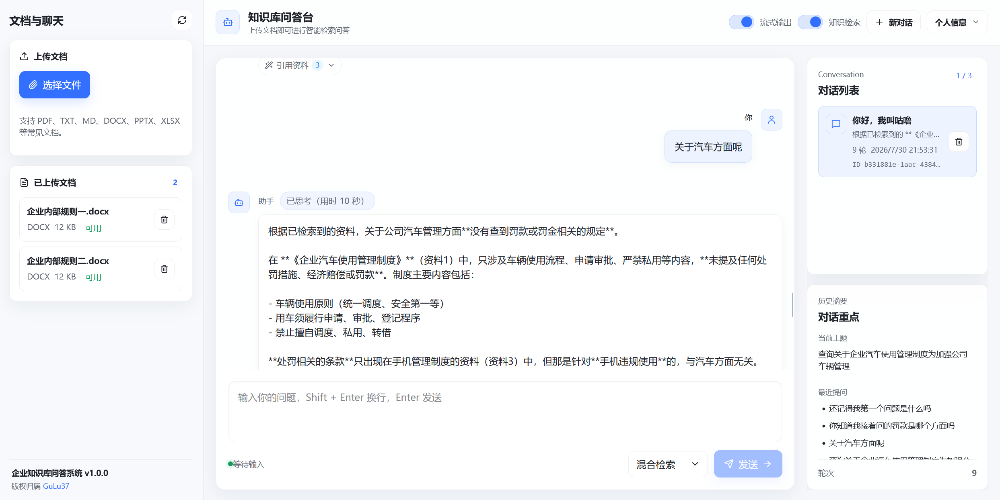
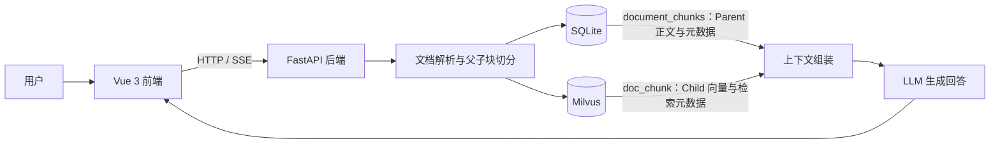
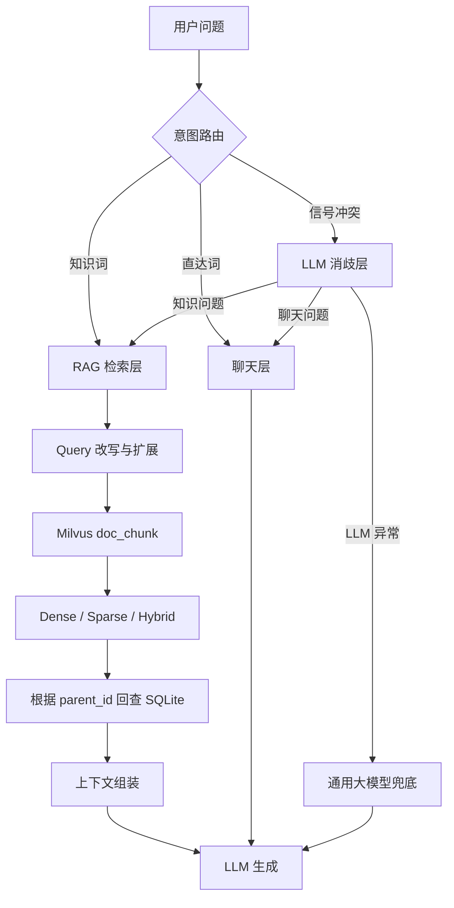

# 企业知识库问答系统



一个面向企业内部资料的 RAG 问答系统，支持文档上传、父子块切分、向量检索、混合检索、流式回答、引用资料展示、会话记忆和账号管理。

## 核心能力

- 意图路由：直达词命中时直接聊天，知识词命中时进入 RAG；两类信号同时命中时交给 LLM 消歧，LLM 异常时进入通用大模型兜底。
- 文档入库：支持 PDF、TXT、Markdown、Word、PowerPoint、Excel 等常见格式。
- 混合检索：支持稠密检索、稀疏检索、Hybrid 检索、Multi-Query、RRF 融合和重排。
- 上下文增强：Child 命中后根据 `parent_id` 从 SQLite 读取完整 Parent 文本。
- 交互体验：回答支持流式输出；引用资料在完整回答结束后再显示。
- 会话记忆：支持多会话、长期记忆和用户画像记忆。

## 技术亮点

### Skill + MCP 可插拔能力体系

技能与工具现在统一收敛到 `backend/app/skills/registry.py`，由这里统一输出能力目录、Function Calling schema 和执行入口。

当前已抽象出三类标准化 Skill：

- `document_hot_word_statistics`：按文件名或文档 ID 查询文档热词
- `memory_query`：查询用户画像记忆和长期事件记忆
- `delete_profile_memory`：删除指定用户的画像记忆

RAG 也被视为工具之一，统一以 `search_knowledge_base` 进入 Function Calling。

Function Calling 工具列表是 Skill 的发现入口，包含 Skill 名称、适用范围和参数说明。模型选中某个 Skill 后，后端才按名称加载对应目录中的详细文档，并将其用于本次执行和回答。

后端同时保留远程 MCP manifest 注册层，未来可直接把 MCP 工具适配成新的 Skill 暴露给 Agent。

当前已提供：

- `GET /api/v1/skills`
- `GET /api/v1/skills/capabilities`
- `GET /api/v1/skills/function-calling`
- `POST /api/v1/skills/execute`


#### 运行边界

- 意图路由与技能分支：单轮最多 2 次工具调用，仍未完成时自动转为澄清或结束。
- RAG 检索分支：进入 ReAct 检索决策循环，模型自主选择检索方式（dense / sparse / hybrid）与 `top_k` 迭代检索；无工具调用视为检索完成，达到 `REACT_MAX_ITERATIONS`（默认 3 轮）强制结束；ReAct 决策失败或无结果时回退 Adaptive-RAG 规则决策。循环仅暴露检索工具，不开放记忆查询/热词统计等技能（技能由意图路由分流）。
- 工具调用必须经过 Function Calling 入口，不再走单独的旁路执行。
- 技能、工具、MCP 的调用都会在后端显式输出，便于排查和审计。

详细评估见 [docs/skill_mcp_highlight_assessment.md](docs/skill_mcp_highlight_assessment.md)。

### Agent 化决策体系

检索与路由决策统一遵循「规则前置分流 → 模型消歧决策 → 规则降级兜底」三级级联思想，按场景落地为以下机制。

#### Adaptive-RAG 检索决策

`backend/app/rag/adaptive.py` 实现规则版自适应控制器：

- `select_initial`：按查询特征选择检索策略——编号查询走稀疏精确匹配，结构化/多条件查询扩大候选，流程制度类保持混合，通用问题混合兜底。
- `assess_evidence`：以最高分、关键词覆盖、编号命中判定证据是否充分；落在模糊区间时交给 LLM 消歧决策，失败回退规则阈值。
- `plan_follow_up`：证据不足时切换检索方式并改写查询重试（上限 2 轮）。

#### ReAct 检索决策循环

RAG 分支（`_run_rag_react_loop`）由模型自主决策检索：仅暴露 `search_knowledge_base` 工具（可指定 `retrieval_method` / `top_k`），模型观察检索结果后决定换参数重试或停止；无工具调用视为检索完成，达到 `REACT_MAX_ITERATIONS`（默认 3 轮）强制结束；模型不可用或无结果时自动回退 Adaptive-RAG 规则决策。技能类能力仍由意图路由统一分流，检索循环内不开放记忆查询/热词统计。

#### 检索性能优化

- 检索结果缓存：相同查询（规范化）在 TTL 内直接返回，重复/相似问题与 ReAct 循环内重复检索显著降延迟；文档入库或删除后自动失效。
- ReAct 循环同查询去重：模型重复检索同一查询时跳过执行。
- Multi-Query 变体精简：查询扩展上限 3 条，控制单次检索开销。

## 最终存储架构

Parent 是切块时的逻辑概念，不再单独建立 Milvus Parent 表。



### 两类存储的职责

| 存储 | 表或 collection | 保存内容 | 主要用途 |
| --- | --- | --- | --- |
| SQLite | `document_chunks` | Parent 正文、`document_id`、`parent_id`、块序号 | 文档预览、Parent 上下文回填 |
| Milvus | `doc_chunk` | Child 文本、向量、`document_id`、`child_id`、`parent_id`、`parent_index` | Dense、Sparse 和 Hybrid 检索 |
| Milvus | `memory_chunks` | 会话和长期记忆向量 | 记忆召回 |

`doc_chunk.parent_id` 与 SQLite `document_chunks.parent_id` 对应。检索命中 Child 后，后端使用 `document_id + parent_id` 回查 SQLite，避免维护第二份 Parent 向量数据。

## 检索流程



RAG 检索层内部为 ReAct 检索决策循环：模型以 `search_knowledge_base` 工具（可指定 `retrieval_method` / `top_k`）自主执行检索，观察结果后可换参数重试；Adaptive-RAG 规则层提供查询特征信号与失败兜底。循环仅暴露检索工具，技能类能力仍由意图路由统一分流。

完整回答返回后，前端再显示引用资料按钮。这样首屏可以尽快开始呈现回答，引用区域不会阻塞主要内容。

## 技术栈

| 模块 | 技术 |
| --- | --- |
| 前端 | Vue 3、Vite、Lucide |
| 后端 | Python、FastAPI、Uvicorn、SQLAlchemy、Loguru |
| 检索 | LangChain、BGE Embedding、BM25、RRF、Reranker |
| 模型服务 | Ollama、OpenAI、DeepSeek、OpenRouter、Anthropic |
| 存储 | Milvus / Milvus Lite、SQLite（默认）、MySQL（可选） |
| 部署 | Docker、Docker Compose |

## 快速开始

### 环境要求

- Python 3.10+
- Node.js 18+
- Milvus 2.x 或 Milvus Lite
- 一个可用的大模型服务

### 本地开发

1. 配置并安装后端：

```bash
cd backend
python -m venv .venv
.venv\Scripts\Activate.ps1
pip install -r requirements.txt
Copy-Item .env.example .env
```

2. 在 `backend/.env` 中填写模型服务配置。文档向量 collection 固定使用：

```env
MILVUS_DOC_COLLECTION_NAME=doc_chunk
MILVUS_CHILD_COLLECTION_NAME=doc_chunk
MILVUS_MEMORY_COLLECTION_NAME=memory_chunks
```

3. 启动后端：

```bash
uvicorn app.main:app --host 0.0.0.0 --port 8000 --reload
```

4. 启动前端：

```bash
cd ../frontend
npm install
npm run dev
```

前端默认访问 `http://127.0.0.1:5173`。

### Docker 部署

先准备环境文件：

```bash
Copy-Item backend/.env.example backend/.env
Copy-Item frontend/.env.example frontend/.env
```

按部署环境填写以下配置：

| 配置 | 说明 |
| --- | --- |
| `LLM_PROVIDER` | 选择 `ollama`、`openai`、`deepseek`、`openrouter` 或 `anthropic` |
| 对应模型 API Key | 按所选模型服务填写 |
| `VECTOR_STORE_TYPE` | `milvus` 使用服务端 Milvus，`milvus_lite` 使用本地轻量文件库 |
| `MILVUS_HOST` / `MILVUS_PORT` | 服务端 Milvus 地址 |
| `MILVUS_LITE_PATH` | Milvus Lite 本地文件路径 |
| `DATABASE_URL` | 默认使用 SQLite，也可切换到 MySQL |
| `JWT_SECRET_KEY` | 生产环境必须替换为强随机密钥 |
| `frontend/.env` 中的 `VITE_API_BASE_URL` | 同域部署通常使用 `/api/v1` |

启动：

```bash
docker compose up -d --build
```

低配展示环境可以使用 Milvus Lite：

```bash
docker compose -f docker-compose.yml -f docker-compose.lite.yml up -d --build
```

如需启用 MySQL：

```bash
docker compose --profile mysql up -d --build
```

常规 Compose 不包含服务端 Milvus；使用 `VECTOR_STORE_TYPE=milvus` 时，需要自行提供可访问的 Milvus 服务。Milvus Lite 数据默认持久化到 `backend/app/data/milvus_lite.db`。

## 常用配置

完整配置见 [backend/.env.example](backend/.env.example)。

| 配置项 | 作用 |
| --- | --- |
| `LLM_PROVIDER` | 默认大模型供应商 |
| `LLM_TIMEOUT` | 单次模型请求超时时间 |
| `LLM_MAX_FALLBACK_ATTEMPTS` | 通用大模型最多尝试的供应商数量 |
| `VECTOR_STORE_TYPE` | `milvus` 或 `milvus_lite` |
| `MILVUS_DOC_COLLECTION_NAME` | 文档向量 collection，当前应为 `doc_chunk` |
| `MILVUS_CHILD_COLLECTION_NAME` | Child 检索 collection，当前应为 `doc_chunk` |
| `MILVUS_MEMORY_COLLECTION_NAME` | 长期记忆 collection |
| `DATABASE_URL` | 文档元数据和 Parent 文本数据库 |
| `BGE_MODEL_NAME` | BGE 模型名称或本地路径 |
| `SEARCH_TOP_K` | 检索召回数量 |
| `SIMILARITY_THRESHOLD` | 相关性过滤阈值 |

## 项目结构

```text
.
├── backend/
│   ├── app/
│   │   ├── api/          # 接口路由
│   │   ├── core/         # LLM、Embedding、常量
│   │   ├── skills/       # Skill 注册、能力目录、技能文档
│   │   │   ├── memory_query/memory_query.md
│   │   │   ├── document_hot_word_statistics/document_hot_word_statistics.md
│   │   │   └── delete_profile_memory/delete_profile_memory.md
│   │   ├── rag/          # 检索实现
│   │   ├── services/     # 业务编排
│   │   ├── tools/        # 统一工具封装与 tracing
│   │   ├── storage/      # SQLite / Milvus 访问
│   │   └── main.py
│   ├── tests/
│   ├── Dockerfile
│   └── requirements.txt
├── frontend/
│   ├── src/
│   ├── Dockerfile
│   ├── nginx.conf
│   └── package.json
├── docs/
│   ├── images/demo.png
│   └── rag_accuracy_demo/
├── docker-compose.yml
├── docker-compose.lite.yml
└── README.md
```

## 使用建议

- 文档标题尽量写清主题、版本和生效日期。
- 表格资料尽量保留表头，不要只上传截图。
- 对例外情况单独成节，写清触发条件和审批人。
- 查询时补充金额、时间、部门、项目或环境，通常更容易命中准确上下文。
- 如果是需要技能处理的问题，优先写清文件名或记忆目标，系统会先看工具列表，再按需展开对应 Skill。

## 许可证

本仓库当前未单独声明许可证，默认请按作者说明使用。
