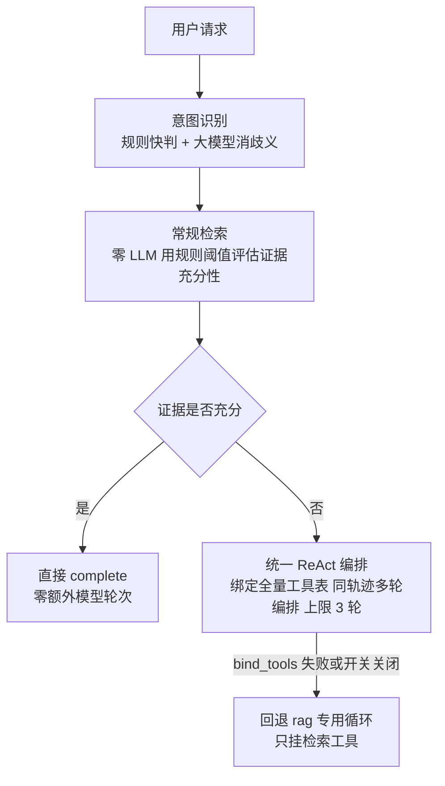
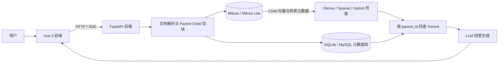

# 企业知识库问答系统


一个面向企业内部资料的知识库问答系统，提供文档上传与解析、Parent-Child RAG 检索、流式对话、资料引用、会话记忆、用户认证和可扩展的 Skill / MCP 能力注册。

## 功能概览

- **文档管理**：支持 PDF、TXT、Markdown、Word、PowerPoint、Excel 等常见格式；上传后异步解析、切块并写入向量库。
- **多路检索**：支持 Dense、Sparse（BM25）和 Hybrid 检索，结合 Multi-Query、RRF 融合、规则重排以及可选 Cross-Encoder 精排。
- **智能动作路由**：先判断用户请求应直接回答、调用 Skill，还是进入知识库检索；明确的记忆、文档统计和工具目录请求可直接路由到对应 Skill。
- **ReAct 编排**：普通检索证据不足时升级为 Agent 编排——默认绑定完整工具注册表（RAG 检索 + 本地 Skill + 远程 MCP）跨工具自主决策；供应商不支持工具绑定时降级为仅检索的 rag 专用循环。
- **引用与流式回答**：聊天接口支持 SSE 流式输出，并传递 `tool_call`、`tool_result` 和资料来源事件。
- **多层记忆**：支持当前用户的画像记忆、长期语义记忆、原始对话块、短期窗口/摘要记忆，以及从摘要渐进式展开原始对话。
- **认证与运维**：支持注册、登录、刷新令牌、密码修改、健康检查、模型/Embedding 预热和后台记忆维护。

## 请求处理链路



### 路由与 ReAct 的职责边界

1. `route_query_action` 是请求级动作路由入口。
2. 规则优先识别特殊 Skill 请求；其余请求先根据知识词、直答词、编号等信号判断，低置信或冲突场景再交给 LLM。
3. LLM 动作选择使用统一工具目录和 Function Calling schema。`search_knowledge_base` 与本地 Skill 在同一工具注册表中，但 RAG 会被转换为独立的 `rag` 分支。
4. RAG 分支先做一轮常规检索：规则路径选择第一次检索方式和 `top_k`，并通过统一工具入口执行一次检索。
5. 如果第一轮常规检索的证据不足，进入 ReAct 编排接手（默认统一编排循环，见第 6 条）。ReAct 可以观察结果后更换 query、`retrieval_method` 或 `top_k` 再检索。
6. ReAct 升级路径分两档：统一 ReAct 编排循环（`_run_unified_react_loop`，默认开启）绑定**完整工具注册表**（RAG 检索 + 本地 Skill + 远程 MCP），最多运行 `UNIFIED_REACT_MAX_ITERATIONS` 轮（默认 3）；当开关关闭或供应商不支持工具绑定时，回退到只暴露 `search_knowledge_base` 的 rag 专用循环（`_run_rag_react_loop`，最多 `REACT_MAX_ITERATIONS` 轮，默认 3）。
7. ReAct 同一轮中的多个工具调用会并行执行（检索与远程调用均为 IO 密集），并对相同工具 + 相同参数的调用去重；走过检索后会按规则评估证据充分性，充分即提前结束，避免过度检索拉长延迟。模型绑定工具失败或没有产出结果时，主链路使用已获得的结果收尾。

### ReAct Agent 运行链路（简化）

系统不会让每个问题都跑 Agent 循环，而是"普通检索优先、证据不足才升级编排"，把多轮模型调用的成本留给真正复杂的问题：

1. **意图识别**：规则快判能直接短路的问题（约 37% 的路由判断零模型调用）不再进入 Agent；其余请求由模型在统一工具表（RAG 检索 + 记忆/热词/文件清单等本地 Skill + 已配置的远程 MCP）中选择直接回答、调用 Skill、澄清或检索。
2. **普通 RAG 一轮收口**：已判定为 RAG 的请求先做一轮零模型的常规检索；规则证据足够就直接组装回答，不升级，也不付额外模型轮次。
3. **升级统一 ReAct 编排**：证据不足时进入 `_run_unified_react_loop`。模型在同一条对话轨迹里跨工具编排——可以改写检索词、更换检索方式（dense/sparse/hybrid）、调整返回条数，也可以先查记忆、再补检索、再看文件清单，每轮都能看到自己上一步的工具结果（Observation）。
4. **回合内工程约束**：同一轮多个互不依赖的工具调用并行执行；相同工具 + 相同参数自动去重；工具执行失败会把错误反馈给模型，由它换路或改参重试，而不是空手继续；走过检索后由规则判定证据充分即提前停止，全程最多 `UNIFIED_REACT_MAX_ITERATIONS`（默认 3）轮。
5. **降级保底**：模型供应商不支持工具绑定（`bind_tools` 失败）或 `UNIFIED_REACT_ENABLED=false` 时，回退到只暴露检索工具的 rag 专用循环；仍无结果则用已有检索结果收尾，明确告知用户，不中断链路。

环境开关：`UNIFIED_REACT_ENABLED`（默认 `true`）、`UNIFIED_REACT_MAX_ITERATIONS`（默认 `3`）、`UNIFIED_REACT_PARALLEL_WORKERS`（默认 `4`）。

## 技术亮点

### 1. 统一 Skill / Tool 注册与执行

`backend/app/skills/registry.py` 统一维护能力定义、公开目录、Function Calling schema 和执行入口。所有模型选择的工具都经过 `execute_agent_tool`，RAG 也不再有独立的旁路执行协议。

当前内置 Skill：

| Skill | 用途 |
| --- | --- |
| `list_available_tools` | 展示当前 Agent 注册表中的工具和 Skill |
| `list_knowledge_base_files` | 列出、筛选和概括已上传文档 |
| `document_hot_word_statistics` | 统计指定文档的高频词 |
| `memory_query` | 查询当前用户的画像记忆和长期记忆 |
| `memory_retrieve_original` | 根据摘要引用渐进式展开当前用户的原始对话 |
| `delete_profile_memory` | 删除当前用户指定的画像记忆 |

RAG 使用统一工具名 `search_knowledge_base`。工具描述和参数 schema 是 Agent 的发现入口；被选中的本地 Skill 才会进一步读取同名目录中的详细规则文档。

远程 MCP 当前支持 **manifest 注册适配**：配置中的 manifest 会转换为 `remote_mcp` Skill 并出现在能力目录中，但仓库现状仍是占位执行器，尚未接入远程 MCP 服务的实际调用。因此不能把它视为已经完成的远程工具执行能力。

相关接口：

- `GET /api/v1/skills`：Skill 定义目录
- `GET /api/v1/skills/capabilities`：统一能力目录和工具 schema
- `GET /api/v1/skills/function-calling`：Function Calling 工具列表
- `POST /api/v1/skills/execute`：执行指定 Skill

### 2. Parent-Child RAG 与结构化数据增强

- 文章类文档先按标题和句子切分，尽量保留章节层级。
- 普通文档默认生成 Parent（约 500 字符）和 Child（约 150 字符）；Child 建立向量索引，Parent 保存完整上下文。
- PDF、Word、Markdown、TXT 等文章类内容使用章节感知切分；CSV、XLS、XLSX 等结构化内容保留 Sheet、表头和完整数据行。
- 结构化查询命中某个 Sheet 后，会从 SQLite 回收同一 Sheet 的多行 Parent 证据，适合名单、统计、筛选和字段查询。
- 检索命中 Child 后，通过 `document_id + parent_id` 从 SQLite 回查 Parent 文本，避免额外维护 Parent 向量表。

### 3. 多阶段检索与重排

一次 `search_knowledge_base` 调用包含以下步骤：

1. 生成最多 3 个查询变体；编号类查询保留原始编号并生成编号变体。
2. 根据请求选择 Dense、Sparse 或 Hybrid 检索。Hybrid 会并行执行 Dense / Sparse，再进行 RRF 融合。
3. 通过关键词覆盖、编号命中、结构化字段等规则进行候选过滤和重排。
4. `CROSS_ENCODER_ENABLED=true` 时，对候选池前 N 条进行 Cross-Encoder 精排；默认关闭，不影响基础检索链路。
5. 去重、补 Parent 上下文并组装有限长度的 RAG context。

检索结果支持进程内 TTL 缓存。文档入库或删除后会清空缓存；ReAct 循环也会跳过同 query 的重复检索。

### 4. 记忆的渐进式披露

系统将记忆分成画像、长期语义摘要和原始对话块。通常只向回答模型注入必要的摘要和短窗口历史；当用户明确要求“完整对话”“原文”或“具体细节”时，才通过 `memory_retrieve_original` 按摘要引用展开原始对话，减少上下文开销并限制数据暴露范围。

长期记忆按用户隔离，后台线程会定期刷新重要性、处理过期事件并清理低价值记录。删除会话时会同步删除该会话关联的长期记忆。

### 5. 可观测性与启动性能

- Skill、RAG 工具以及异常都会输出结构化 tracing 日志。
- 后端启动时在后台预热 LLM、Embedding 和可选 Cross-Encoder，并异步初始化 Milvus，不阻塞 HTTP 服务启动。
- `/api/v1/chat/runtime-status` 可查看模型和向量运行时状态。
- RAG 和 Skill 的执行结果通过 SSE 事件传给前端，便于展示工具调用状态和来源资料。

## 存储架构



| 存储 | 表或 collection | 内容 | 用途 |
| --- | --- | --- | --- |
| SQLite / MySQL | `document_records` | 文件元数据和生命周期状态 | 文档列表、上传状态、删除状态 |
| SQLite / MySQL | `document_chunks` | Parent 正文、`document_id`、`parent_id`、块序号 | 文档预览、Parent 上下文回填 |
| Milvus / Milvus Lite | `doc_chunk` | Child 文本、向量、`document_id`、`child_id`、`parent_id` 等 | Dense、Sparse、Hybrid 检索 |
| Milvus / Milvus Lite | `memory_chunks` | 画像、摘要和对话记忆向量 | 当前用户记忆召回 |

Parent 是切块和上下文回填概念，不会单独建立 Milvus Parent collection。`doc_chunk.parent_id` 与元数据数据库中的 `document_chunks.parent_id` 对应。

## API 概览

除认证接口外，文档、检索、聊天和 Skill 接口都需要当前用户的 Bearer Token。

| 分组 | 接口 | 说明 |
| --- | --- | --- |
| Auth | `POST /api/v1/auth/register` | 注册并返回令牌 |
| Auth | `POST /api/v1/auth/login` | 登录 |
| Auth | `POST /api/v1/auth/refresh` | 刷新令牌 |
| Auth | `POST /api/v1/auth/password` | 修改密码并轮换令牌 |
| Auth | `GET /api/v1/auth/me` | 当前用户信息 |
| Documents | `POST /api/v1/documents/upload` | 上传文档并异步入库 |
| Documents | `GET /api/v1/documents/list` | 分页获取文档列表 |
| Documents | `GET /api/v1/documents/content/{document_id}` | 获取文档正文预览 |
| Documents | `DELETE /api/v1/documents/delete/{document_id}` | 请求删除文档 |
| Retrieval | `POST /api/v1/retrieval/search/hybrid` | Hybrid 检索 |
| Retrieval | `POST /api/v1/retrieval/search/dense` | Dense 检索 |
| Retrieval | `POST /api/v1/retrieval/search/sparse` | Sparse 检索 |
| Chat | `POST /api/v1/chat/generate` | 同步生成回答 |
| Chat | `POST /api/v1/chat/stream` | SSE 流式回答 |
| Chat | `GET /api/v1/chat/runtime-status` | 查看后台预热状态 |
| Chat | `POST /api/v1/chat/warmup` | 手动触发预热 |
| Chat | `POST /api/v1/chat/consolidate` | 合并会话摘要记忆 |
| Chat | `GET /api/v1/chat/conversations` | 获取当前账号跨浏览器共享的对话列表 |
| Chat | `PUT /api/v1/chat/conversations/{conversation_id}` | 保存单个对话记录 |
| Chat | `DELETE /api/v1/chat/conversations` | 清空当前账号的全部对话记录与长期记忆 |
| Chat | `DELETE /api/v1/chat/conversations/{conversation_id}` | 删除会话及关联长期记忆 |

根路径 `/` 返回应用信息，`/health` 提供健康检查，FastAPI 文档位于 `/docs`。

## 技术栈

| 模块 | 技术 |
| --- | --- |
| 前端 | Vue 3、Vite、Lucide Vue |
| 后端 | Python、FastAPI、Uvicorn、SQLAlchemy、Loguru |
| LLM 编排 | LangChain Core、Function Calling、ReAct 检索循环 |
| 检索 | Milvus、BGE Embedding、BM25、RRF、规则重排、可选 Cross-Encoder |
| 模型服务 | Ollama、OpenAI、DeepSeek、OpenRouter、Anthropic |
| 文档解析 | Unstructured、pypdf、python-docx、python-pptx、openpyxl 等 |
| 数据存储 | SQLite（默认）、MySQL（可选）、Milvus / Milvus Lite |
| 部署 | Docker、Docker Compose、Nginx |

## 快速开始

### 环境要求

- Python 3.10+；Docker 镜像使用 Python 3.13。
- Node.js 18+；Docker 前端构建使用 Node.js 22。
- 可访问的 LLM 服务。
- 服务端 Milvus 2.x，或使用 Milvus Lite。

### 本地开发

1. 准备后端环境：

```powershell
cd backend
python -m venv .venv
.venv\Scripts\Activate.ps1
pip install -r requirements.txt
Copy-Item .env.example .env
```

2. 编辑 `backend/.env`，至少配置 LLM、Embedding 和向量库。开发时可以使用服务端 Milvus：

```env
VECTOR_STORE_TYPE=milvus
MILVUS_HOST=localhost
MILVUS_PORT=19530
```

如果使用 Milvus Lite：

```env
VECTOR_STORE_TYPE=milvus_lite
MILVUS_LITE_PATH=./data/milvus_lite.db
BGE_DEVICE=cpu
BGE_LOCAL_FILES_ONLY=true
```

3. 启动后端：

```powershell
uvicorn app.main:app --host 0.0.0.0 --port 8000 --reload
```

4. 新开终端启动前端：

```powershell
cd frontend
npm install
npm run dev
```

前端默认访问 `http://127.0.0.1:5173`，默认 API 地址为 `/api/v1`。前后端分域时，在 `frontend/.env` 中设置 `VITE_API_BASE_URL`。

### Docker Compose

先准备配置文件：

```powershell
Copy-Item backend/.env.example backend/.env
Copy-Item frontend/.env.example frontend/.env
```

生产环境至少应修改：

| 配置 | 说明 |
| --- | --- |
| `LLM_PROVIDER` 及对应模型配置 | 选择并配置 Ollama、OpenAI、DeepSeek、OpenRouter 或 Anthropic |
| `VECTOR_STORE_TYPE` | `milvus` 使用外部服务端 Milvus；`milvus_lite` 使用本地文件库 |
| `MILVUS_HOST` / `MILVUS_PORT` | 服务端 Milvus 地址 |
| `MILVUS_LITE_PATH` | Milvus Lite 文件路径 |
| `DATABASE_URL` | 默认 SQLite，也可配置 MySQL |
| `JWT_SECRET_KEY` | 非调试环境必须使用至少 32 位随机密钥 |
| `BOOTSTRAP_ADMIN_PASSWORD` | 非调试环境不能使用示例密码 |
| `frontend/.env` 的 `VITE_API_BASE_URL` | 同域部署通常使用 `/api/v1` |

启动完整前端和后端：

```powershell
docker compose up -d --build
```

低配或单机展示环境使用 Milvus Lite：

```powershell
docker compose -f docker-compose.yml -f docker-compose.lite.yml up -d --build
```

启用 Compose 中的 MySQL profile：

```powershell
docker compose --profile mysql up -d --build
```

注意：`docker-compose.yml` 本身不会启动服务端 Milvus。使用 `VECTOR_STORE_TYPE=milvus` 时，需要提前提供可访问的 Milvus 服务；Lite 模式的数据默认持久化在 `backend/app/data/milvus_lite.db`。

## 关键配置

完整配置项见 [backend/.env.example](backend/.env.example)。常用配置如下：

| 配置项 | 作用 |
| --- | --- |
| `LLM_PROVIDER` | 默认 LLM 提供商 |
| `LLM_MAX_FALLBACK_ATTEMPTS` | LLM 供应商失败时最多尝试的供应商数量 |
| `VECTOR_STORE_TYPE` | `milvus` 或 `milvus_lite` |
| `MILVUS_DOC_COLLECTION_NAME` | 文档 Child collection，默认 `doc_chunk` |
| `MILVUS_CHILD_COLLECTION_NAME` | Child 检索 collection，默认 `doc_chunk` |
| `MILVUS_MEMORY_COLLECTION_NAME` | 记忆 collection，默认 `memory_chunks` |
| `DATABASE_URL` | 文档元数据和 Parent 文本数据库 |
| `BGE_MODEL_NAME` | BGE 模型名或本地路径 |
| `SEARCH_TOP_K` | 默认检索数量 |
| `SIMILARITY_THRESHOLD` | Dense 检索阈值配置 |
| `CROSS_ENCODER_ENABLED` | 是否启用 Cross-Encoder 精排，默认关闭 |
| `CROSS_ENCODER_CANDIDATE_K` | Cross-Encoder 精排候选数 |
| `ENABLE_CACHE` / `CACHE_TTL` | 检索结果缓存开关和 TTL |
| `REACT_MAX_ITERATIONS` | RAG ReAct 最大迭代轮数，默认 3 |
| `UNIFIED_REACT_ENABLED` | 统一 ReAct 编排开关，默认 `true`；关闭后回退 rag 专用循环 |
| `UNIFIED_REACT_MAX_ITERATIONS` | 统一 ReAct 编排迭代上限，默认 3 |
| `UNIFIED_REACT_PARALLEL_WORKERS` | 统一 ReAct 单轮并行执行工具调用上限，默认 4 |
| `MEMORY_CLEANUP_INTERVAL_SECONDS` | 后台记忆维护间隔 |

## 项目结构

```text
.
├── backend/
│   ├── app/
│   │   ├── api/          # FastAPI 路由和请求模型
│   │   ├── core/         # LLM、Embedding、常量
│   │   ├── rag/          # 常规检索规划（planner.py）、检索器和重排器
│   │   ├── services/     # 聊天、检索、文档、记忆和认证服务
│   │   ├── skills/       # Skill 注册、内置 Skill、详细规则和 MCP 适配
│   │   ├── storage/      # SQLite / Milvus 访问
│   │   ├── tools/        # RAG 工具和 tracing
│   │   └── main.py       # 应用入口和生命周期管理
│   ├── tests/            # 单元测试
│   ├── Dockerfile
│   └── requirements.txt
├── frontend/
│   ├── src/              # Vue 页面、API 封装和样式
│   ├── Dockerfile
│   ├── nginx.conf
│   └── package.json
├── docs/
│   ├── images/demo.png
│   └── rag_accuracy_demo/ # RAG 演示资料
├── docker-compose.yml
├── docker-compose.lite.yml
└── README.md
```

## 使用建议

- 文档标题尽量包含主题、版本和生效日期，便于章节切分和检索。
- 表格文件保留表头；查询名单、统计和字段时尽量提供文件名、Sheet 名或筛选条件。
- 查询内部流程时补充部门、金额、时间、项目、编号或环境等限定信息。
- 如果要使用记忆能力，请在已登录用户上下文中创建稳定的 `conversation_id`；摘要短期记忆策略要求提供 `conversation_id`。
- 文档状态为 `processing` 时尚未完成索引，只有进入 `ready` 后才适合检索。

## 许可证

本仓库当前未单独声明许可证，默认请按作者说明使用。
